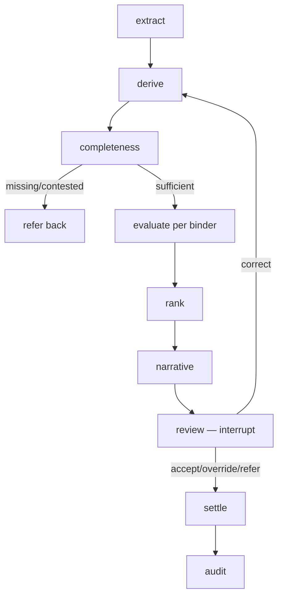

# Binder Selection Agent
## Leadership Presentation — Marine Cargo / Stock Throughput Placement

**Private prototype · v1.9.2 · decision-support, not a binder**

> The system *recommends* where to place a risk. A named underwriter *always decides*. The system never binds.

---

## 1. The problem

- Broker submits a marine cargo / stock throughput risk.
- Underwriter must choose **which binder** (of several) to place it with.
- Today: manual, inconsistent, no audit trail, capacity guessed, rules in people's heads.
- Goal: deterministic, auditable, repeatable recommendation — humans still decide.

---

## 2. What the system does (one line)

> Read the submission → check completeness → screen capacity per binder → apply each binder's appetite rules → rank eligible binders with a plain-English rationale → underwriter accepts / overrides / refers back → settle + audit.

- Missing information → **Refer** or an information request, never a silent Pass.
- Every rule is data (versioned JSON), never prompt text or code.
- No LLM in any decision — extraction only.

---

## 3. Architecture (gate chain)



- **One engine, N binders** — binders are data (`rules/binder_*_v*.json`), not agents.
- Correction loop returns to `derive` so re-evaluation re-runs every gate.

---

## 4. UI tour — header & "At a glance"

**Header** (`ui/index.html`)
- Title: "Binder Selection Agent — leadership demonstration"
- Subtitle: decision-support for marine cargo / stock throughput; system never binds.
- Badges: Private prototype · Deterministic rules (no LLM decisions) · Missing data → Refer, never silent Pass · Full audit trail.

**At a glance (KPIs)**
- One card per binder: `binder_id` · status · ruleset version · rule count.
- Sample case count card.
- Scoring weights + tie-break line.

---

## 5. UI tour — "How it works (business view)"

Numbered business flow (8 steps, no jargon):
1. **Read** — pull risk facts from broker documents, each with source + confidence.
2. **Completeness check** — missing mandatory → named information request to broker.
3. **Capacity screen** — free capacity derived (line − written − reserved); full binders excluded with shortfall stated.
4. **Appetite rules** — every rule → Pass / Decline / Cannot-assess.
5. **Rank & explain** — eligible binders ranked by published score + plain-English rationale.
6. **Underwriter decides** — accept / override (with reason code) / refer back. Overrides & corrections recorded.

---

## 6. UI tour — Section 1 "Pick a submission"

**Sample submission dropdown** (27 realistic cases, sorted; `demo-accept-full` first)
- `caseinfo` line shows what the case tests (covers list).

**File upload** (real documents)
- Accepts: pdf, eml, xlsx, csv, docx, msg, png/jpg/tiff.
- Limits: max 10 files, 10 MB each.
- msg/images report explicit statuses (no silent skip).

**Extractor toggle**
- `stub` (deterministic, keyless, byte-identical) — default.
- `nemotron-120b live` (needs server `NVIDIA_API_KEY`) — reads real files.
- Note: stub cannot read file text by design (must never invent values).

**Run evaluation button** → triggers `/api/run`.

**Stages strip** — parse → extract → derive → completeness → evaluate → rank → narrative (or HALTED).

**Documents (parse status) table** — per doc: id, format, status chip (Pass/Refer/Decline), detail (failure reason / truncated).

---

## 7. UI tour — Extracted facts & Recommendation

**Extracted facts table** — columns: Fact, Value, Conf, Source.
- Every field shows its value, confidence, and source document id (provenance).

**Recommendation card** — shows recommendation (or halt) + scores JSON.
- If a dataset case: "Dataset expects: …"
- If halted at completeness on uploaded files: hint to switch to live extractor.

**Per-binder results** — one table per binder:
- Header: binder id · outcome (Accept/Decline/Refer/Excluded/Failed) · reason · ruleset version.
- Rows: Rule id · Outcome chip · Value / reason.

**Plain-English summary** — the narrative (advisory only, never "bound/placed").

---

## 8. UI tour — Section 2 "Underwriter decision"

**Inputs**
- Underwriter name (default `demo-underwriter`).
- Action: Accept recommendation / Override (pick different binder) / Refer back for information.
- Selected binder (override only): binder_A / binder_B.
- Reason code (override only): PRIOR_RELATIONSHIP, CAPACITY_PREFERENCE, TERMS_NEGOTIATED, BROKER_REQUEST, OTHER.

**Record decision button** → `/api/decide`.

**Settlement result table** — Decision · Settlement · Audit id.

**Evidence pack** — full auditor view (preformatted):
- extracted values with confidence + source
- corrections (if any)
- binder outcomes + rule outcomes
- recommendation + scores
- decision (action, selected binder, underwriter, timestamp)
- settlement, models, timings, supersession links.

---

## 9. UI tour — Section 3 "Management picture"

**Refresh dashboard button** → `/api/mi`.

**KPI cards**
- Evaluations this demo.
- Outcome mix (by_outcome).
- Overrides / decided.
- Info requests.

**Full MI JSON** (preformatted) — volume_mix, decline_reasons, override_rate, data_quality, refer_by_field, stage_timing.

---

## 10. UI tour — Guardrails & honest limits

- Rules live in versioned data with approval — never in prompts or code. Changing appetite needs no software release.
- Missing information → Refer or an information request, never a quiet Pass.
- Every evaluation immutable and replayable; corrections create linked successor records.
- Not yet production: sign-in/roles, live capacity & geo-data feeds, real OCR engine, 10 business decisions awaiting owners (bands, tie-breaks, severity, retention).

---

## 11. Binders

**Registry** (`rules/binders.json`) — lifecycle: active / suspended / retired, effective dates.

| Binder | Status | Rules | Classification |
|---|---|---|---|
| binder_A | active | 9 (v2, 2026-09-30+) | preferred |
| binder_B | active | 7 (v1) | standard |
| binder_C/D/E | active | (added in v1.0) | — |

- **Binder A rules** (9, Appendix A full): section limit, TIV, single/total claims, continental US, sprinkler, valuation, coverage type + inception, expiring premium, commodity.
- **Binder B rules** (7): territory/wildfire/FEMA (OR), prior coverage cancelled/non-renewed, frame-without-alarm (AND, per-site), built before 1950, selling-price valuation, profit share/NCB, new venture <1yr, livestock.
- Effective-date versioning: `load_effective(binder, date)` → v1 before 2026-09-30, v2 after.
- Strategic classification (preferred/standard) feeds scoring.

---

## 12. Sample cases

**Dataset** (`samples/cases/01–27*.json` + `manifest.json`)
- 27 realistic cases, each with documents, own capacity params, expected outcome, covers list.
- Categories: accept, decline (various rules), refer (missing data), conflict, capacity shortfall, excluded binder.

**Parsing fixtures** (`samples/parsing/`) — 25 files (5 per type: pdf, docx, xlsx, eml, txt) + negatives.

**Demo case** `demo-accept-full` — clean accept through all gates.

**Live-verified**: OpenRouter free model `liquid/lfm-2.5-2.6b:free` extraction tested end-to-end.

---

## 13. Correction loop (live demo moment)

1. Two docs disagree on TIV (e.g. 20M vs 6M) → `extracted_meta.total_insured_value.contested = true`, conflict list with both provenances.
2. Completeness flags contested → surfaced in review question.
3. Underwriter sends `{action: "correct", corrections: {total_insured_value: 5000000}}`.
4. Graph routes back to `derive` → re-runs evaluate → rank → narrative → review.
5. Correction trail preserved: `pre_correction_value`, `corrected_by`, `corrected_at`, `contested=false`, conflict removed.
6. Audit record links via `supersedes`.

---

## 14. Audit & evidence pack

- Every evaluation → immutable JSON line in `audit/decisions.jsonl`.
- Fields: submission ref, extracted meta (with corrections), binder results + rule outcomes + ruleset versions, scores, recommendation, decision (identity + timestamp), settlement, narrative, stage timings, model versions, supersedes.
- `evidence_pack(record)` → single human-readable artefact for auditors.
- Re-evaluations leave the original intact (`supersedes` link, BFR-AUD-004).

---

## 15. MI (management information)

Reports (`reports/mi.py`):
- **volume_mix** — total, by outcome, by broker, by underwriter.
- **decline_reasons** — by rule id.
- **override_rate** — decided, overrides, rate, by reason code.
- **data_quality** — info requests count.
- **refer_by_field** — which fields cause refers.
- **stage_timing** — mean seconds per stage (MI-006).

All from the audit trail — no separate data store.

---

## 16. How to run (3 commands)

```bash
# 1. tests
.\.venv\Scripts\python -m pytest -q          # 79+ passed

# 2. demo (self-resetting)
python demo.py

# 3. leadership UI
python ui/app.py 8080
# → http://127.0.0.1:8080
```

- No API key needed for stub (deterministic).
- Live extraction: set `NVIDIA_API_KEY` or `OPENROUTER_API_KEY` in server env.

---

## 17. Closing — what's real vs. open

**Real today:** deterministic rules, capacity ledger, audit trail, evidence pack, correction loop, MI, 5 binders, 27 sample cases, 25 parsing fixtures, live LLM extraction (2 providers), public GitHub Pages demo.

**Open (business decisions, not code):** 10 OPENs — bands, tie-breaks, severity, retention, auth/roles, live capacity & geo feeds, real OCR engine.

**The engine is ready for all of them — they're data and approvals now, not architecture.**

---

## Q&A

*Drop a fragment — I'll answer verdict-first with pins.*