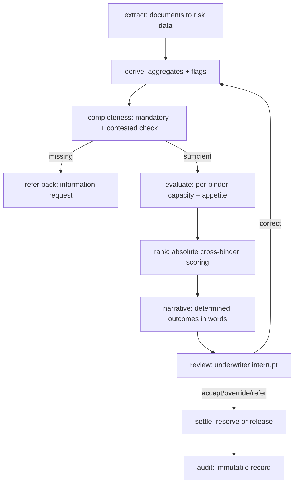

# binderselection-backend — Binder Selection Agent (LangGraph vertical slice)

> Decision-support for marine cargo / stock throughput placement.
> Takes an inbound submission, screens capacity, evaluates binder appetite
> deterministically, ranks eligible binders, and puts a named underwriter
> in charge of the decision. **The solution recommends; a human decides.**

Spec of record: `BUSINESS_FUNCTIONAL_REQUIREMENTS 1.md` (v0.1 Draft for review,
2026-09-17) in the sibling `BSA/` folder, plus `Policy_Referral.json`.
This repo is the executable vertical slice of that spec, built on LangGraph.

- Status: v0.8.0 — two binders (A 9 rules, B 7 rules) as versioned data, multi-binder ranking, correction loop, MI, 79 tests green.
- Visibility: **private**. Do not flip public without remediating §10.
- Stack: Python 3.11, langgraph 1.2.x, langchain-core, pydantic, pytest,
  langgraph-checkpoint-sqlite / postgres.

---

## 1. How it works

### 1.1 Flow (BFR §5.1)



Each node maps to a BFR group:

| Node | File | BFR |
|---|---|---|
| extract | `nodes/extract.py` (+ `extract_openrouter.py` live path) | BFR-EXT, §7.1/7.1.7 |
| derive | `nodes/derive.py` | BFR 7.1.6 derived aggregates |
| completeness | `nodes/completeness.py` | BFR-APP-003 (Refer, never Pass) |
| evaluate | `nodes/multibind.py` + `capacity.py` + `appetite.py` | BFR-CAP, BFR-APP-004/005/010/011 |
| rank | `nodes/multibind.py` + `rules/scoring.json` | BFR-REC-003/005/006 |
| narrative | `nodes/narrative.py` | BFR-REC-007/008/010/011 |
| review | `nodes/review.py` (+ `correct.py`) | BFR-UWR, BFR-EXT-006/007 |
| settle | `nodes/settle.py` + `capacity/ledger.py` | BFR-CAP-008/009 |
| audit | `persistence.write_audit` + `evidence_pack` | BFR-AUD |

### 1.2 Design principle (BFR §3.3) — read this before touching code

| Activity | Mechanism | Why |
|---|---|---|
| Reading documents, extracting fields | LLM (stub now, provider later), with confidence + provenance | Input is unstructured; reading is the point |
| Capacity screening, rule eval, scoring | **Deterministic Python, no LLM** | Must be repeatable, explainable, byte-identical |
| Narrative summary | LLM over already-determined outcomes | Presentation, not decision |

**A model may read and it may explain, but it may not decide.**
`nodes/appetite.py`, `nodes/capacity.py`, `nodes/rank.py` must never import
an LLM client. `nodes/extract.py` must never output Accept/Decline.

### 1.3 State (BFR §7.1 subset / §7.5 subset)

See `state.py` (`SubmissionState`):

- `submission_reference: str` — unique, human-quotable (BFR-SUB-003).
- `documents: list` — `{doc_id, filename?, text?, structured_hint?}`.
  `structured_hint` is the test/dev shortcut; production fills it via LLM.
- `extracted: dict` — flat risk fields consumed by rules
  (`total_insured_value`, `broker_name`, `locations`, `commodities`).
- `extracted_meta: dict` — per-field envelope: `value`, `original_value`,
  `present`, `confidence`, `source_document_id`, `source_locator`
  (BFR-EXT-002, §7.1.7). Absent fields are `present: False`, never inferred
  (BFR-EXT-003). Money keeps original + normalised (BFR-EXT-008).
- `completeness: {missing[], can_evaluate}` — gate for RFI loop.
- `capacity_snapshot: {authorised_line, written_to_date, reserved,
  available_capacity}` — available is **derived**
  (`line − written − reserved`), timestamped at evaluation (BFR-CAP-002/007).
- `rule_outcomes[]: {rule_id, outcome, value?, reason?}` — one of
  Pass / Decline / Cannot-assess (BFR-APP-002). Cannot-assess names the
  missing field and bubbles to Refer (BFR-APP-003/004).
- `binder_outcome: Accept | Decline | Refer | eligible | excluded:…`
- `scores, ranking, recommendation` — absolute scores (BFR-REC-005);
  `"no eligible binder"` with per-binder reasons when nothing accepts
  (BFR-REC-009).
- `decision: {action, selected_binder?, reason_code?, commentary?,
  underwriter_id, decided_at, valid, error?}` — human record (BFR-UWR-006).
- `audit_id` — pointer to the JSONL record.

---

## 2. Repo layout

```
binderselection-backend/
  state.py               SubmissionState (§7.1/7.5 subset)
  graph.py               StateGraph wiring + checkpointer injection
  persistence.py         get_checkpointer() + append-only audit
  nodes/
    __init__.py
    extract.py           LLM-boundary node (stub default)
    completeness.py      MANDATORY gate
    capacity.py          screen(line, written, reserved)
    appetite.py          evaluate() + evaluate_rule() (+binder_id/as_at mode)
    rank.py              absolute-score placeholder
    review.py            interrupt() gate + validate()
  rules/
    store.py             versioning, validation, four-eyes, dry-run, lifecycle
    binders.json         binder registry (status + effective dates)
    binder_A_v1.json     approved ruleset v1 (3 rules, migration slice)
    override_reason_codes.json   BFR-UWR-005 code list (v1, 5 codes)
  tests/
    test_rules.py        bite / non-bite / Cannot-assess (BFR-NFR-034)
    test_extract.py      absent handling, money normalisation, provenance
    test_review.py       accept / reason-required / hard-decline block / refer_back
    test_admin.py        validation / effective load / four-eyes / dry-run / lifecycle
  requirements.txt
  .gitignore             (.venv, *.sqlite, .checkpoints.sqlite, audit/, .env)
```

---

## 3. Prerequisites

- Windows 10/11, PowerShell 5.1, Python 3.11 (`python --version`).
- This checkout lives under OneDrive (user decision 2026-09-29):
  `…/OneDrive - ADROSONIC IT Consultancy Services Pvt. Ltd/Documents/binderselection-backend`.
  Set the folder to **Always keep on this device** and **pause OneDrive sync
  during `git` operations** (§9).
- `pip.exe` is blocked by Application Control on this machine — always use
  `python -m pip`. `uv` is available as an alternative.
- No LLM keys are required for the stub path. Live extraction needs a
  provider package + key (not installed; see §6.4).

---

## 4. Setup

```powershell
# from the repo root
python -m venv .venv
.\.venv\Scripts\Activate.ps1
python -m pip install -r requirements.txt
python -m pytest tests -q
```

Expected: `79 passed`. Installed versions at v0.8.0: `langgraph 1.2.x`,
`langchain-core 1.6.3`, `langgraph-checkpoint-sqlite/postgres 2.x`.

---

## 5. Running the slice

### 5.1 Without persistence (stateless)

```python
from graph import build
g = build()
r = g.invoke({
  "submission_reference": "SUB-001",
  "documents": [{"doc_id": "d1", "structured_hint": {
    "total_insured_value": "$5,000,000", "broker_name": "Acme",
    "locations": [{"sprinklered": True}],
    "commodities": [{"commodity_type": "STEEL"}]}}]})
print(r["binder_outcome"], r["recommendation"])
# Accept binder_A  (pauses at review only when a checkpointer is attached;
# without one, review still interrupts — see 5.2)
```

Walk the three canonical paths:

| Input | Expected |
|---|---|
| 5m TIV, sprinklered, steel | `Accept` → recommend `binder_A` |
| `{}` (no hints) | completeness `can_evaluate: False` → stops, RFI lists `total_insured_value, broker_name, locations` |
| 20m TIV vs 10m available | `excluded: shortfall=10000000.0` → stops before appetite |

Capacity constants for the slice live in `graph.py`:
`CAP_LINE, CAP_WRITTEN, CAP_RESERVED = 15M, 5M, 0` → 10m available.
They are placeholders for the capacity source of record (BFR-INT-003, ASM-1).

### 5.2 With checkpointer + human review (the real loop)

```python
from langgraph.types import Command
from graph import build
from persistence import get_checkpointer

docs = [{"doc_id": "d1", "structured_hint": {
  "total_insured_value": "$5,000,000", "broker_name": "Acme",
  "locations": [{"sprinklered": True}],
  "commodities": [{"commodity_type": "STEEL"}]}}]

with get_checkpointer() as cp:          # SQLite locally;
    g = build(checkpointer=cp)           # Postgres when BINDER_PG_CONN is set
    cfg = {"configurable": {"thread_id": "uw1"}}
    g.invoke({"submission_reference": "SUB-020", "documents": docs}, cfg)
    # → pauses at review with {recommendation, binder_outcome, rule_outcomes}
    done = g.invoke(Command(resume={
        "action": "accept",              # or override | refer_back
        "underwriter_id": "u-test"}), cfg)
    print(done["decision"], done["audit_id"])
```

Review contract (`nodes/review.py`):

- `accept` — allowed only when the recommendation names a binder.
- `override {selected_binder, reason_code, commentary?}` — `reason_code`
  must come from `rules/override_reason_codes.json`
  (`PRIOR_RELATIONSHIP, CAPACITY_PREFERENCE, TERMS_NEGOTIATED,
  BROKER_REQUEST, OTHER`). A binder carrying a **hard-decline** rule outcome
  cannot be selected — the node re-prompts with the blocking rule ids
  (BFR-UWR-005/007).
- `refer_back` — returns `info_request` = completeness gaps + Cannot-assess
  rule fields (feeds the broker information request, BFR-UWR-008).
- Every decision records `underwriter_id + decided_at` (BFR-UWR-006).
- Invalid input re-prompts (max 2 retries) instead of failing silently.

### 5.3 Audit trail

`persistence.write_audit` appends one JSON record per run to
`audit/decisions.jsonl` (gitignored): evaluation id + timestamps, extracted
data + meta, capacity snapshot, `ruleset_version`, every rule outcome,
scores, ranking, recommendation, and the human decision. Replay the record
to reproduce the outcome after rules change (BFR-AUD-003); corrections are
new linked evaluations, never edits (BFR-AUD-004 — `supersedes` links are
roadmap).

---

## 6. Rules administration (BFR-ADM)

### 6.1 Rule model (§7.4)

Approved rulesets live at `rules/binder_<id>_v<version>.json`:

```json
{
  "binder_id": "binder_A", "version": 1, "effective_from": "2026-09-29",
  "rules": [{
    "rule_id": "A-002-TIV", "category": "Total Insured Value",
    "scope": "submission", "field_reference": "total_insured_value",
    "operator": "lte", "threshold_value": 10000000,
    "threshold_unit": "currency", "severity": "refer"}]}
```

Operators: `lte lt gte gt eq neq in not_in is_true is_false is_absent
is_present`. Severity `hard_decline` vs `refer` is OPEN-4 in the BFR —
current slice uses `refer` throughout; the review gate already enforces the
hard-decline block for when severities land.

`rules/store.py` provides:

- `validate_rule(rule)` — field must exist in the §7.1 subset, operator must
  be known, `threshold_unit` required (BFR-ADM-007).
- `load_effective(binder_id, as_at)` — highest version with
  `effective_from <= as_at <= effective_to` (BFR-ADM-003/004).
- `is_active(binder_id, as_at)` — registry check against
  `rules/binders.json` (onboard / suspend / reinstate / retire without code
  change, BFR-ADM-008; suspended binders never reach appetite, BFR-CAP-010).
- `propose(ruleset, author)` / `approve(proposal, approver)` — four-eyes;
  self-approval raises (BFR-ADM-005).
- `dry_run(cases, current, proposed)` — counts + lists outcome flips before
  approval (BFR-ADM-006).

Evaluate against a dated ruleset with provenance:

```python
from nodes import appetite as app
app.evaluate({"extracted": {...}}, binder_id="binder_A", as_at="2026-09-29")
# → {rule_outcomes, binder_outcome, ruleset_version}
```

### 6.2 Current seed rules (Appendix A slice)

`rules/binder_A_v1.json` carries 3 of Binder A's 9 Appendix-A rules:

| rule_id | Appendix-A # | Meaning |
|---|---|---|
| A-002-TIV | A2 | TIV ≤ $10,000,000 |
| A-005-SPRINKLER | A5 | every location sprinklered |
| A-009-COMMODITY | A9 | commodity ∉ cannabis/marijuana/CBD/THC |

Full migration input is Appendix A (43 rules across 5 binders) — not
`Policy_Referral.json`, which has a duplicate Rule 19, typos
(`Helicoptors`, `Rupublic`, `Prodcuts`), and no 7.4 structure. Normalise it
into versioned rulesets before importing.

### 6.3 Binder registry lifecycle

`rules/binders.json`: `binder_A` active, `binder_B` suspended (demonstrates
the `is_active` filter). Onboarding binder #6 is reference-data entry only
(BFR-ADM acceptance). Strategic/preferred classification (BFR-REC-003,
BFR-ADM-010) is OPEN-3 — no source of record yet, so `rank.py` stays a
placeholder returning absolute scores.

### 6.4 Extraction provider hook

`nodes/extract.py::extract(state, llm=None)` — pass a LangChain chat model to
replace the stub; the live path must return the same envelope
(`value/original_value/present/confidence/source_document_id/source_locator`)
and mark unmappable coded values as unmapped → Cannot-assess (BFR-DAT-006/007).
No provider is installed and no keys are configured; the stub path needs
neither. Submission text must never reach logs (BFR-NFR-003) nor train a
third-party model (BFR-DAT-005, ASM-7).

---

## 7. Testing

```powershell
python -m pytest tests -q        # 79 passed at v0.8.0
python -m pytest tests/test_admin.py -q
```

| File | What it proves | BFR trace |
|---|---|---|
| `test_rules.py` | TIV bite / non-bite / Cannot-assess | BFR-APP, BFR-NFR-034 |
| `test_extract.py` | absent stays absent; `$5,000,000` → `5000000.0` + provenance | BFR-EXT-002/003/008 |
| `test_review.py` | accept ok; override needs reason; hard-decline blocked; refer_back lists gaps | BFR-UWR-004..008 |
| `test_admin.py` | bad field/op rejected; effective load; self-approval raises; dry-run flip; suspended filtered | BFR-ADM-001..008 |

Rule-test convention going forward: one submission per rule in biting,
non-biting, and Cannot-assess states, plus score-stability (removing a binder
must not change others' scores) and tie-break cases when OPEN-5 lands.

---

## 8. Configuration and environments

| Variable | Purpose | Default |
|---|---|---|
| `BINDER_PG_CONN` | Postgres checkpointer conn string | unset → local `.checkpoints.sqlite` |
| (none yet) | model id/version pin | stub; must be recorded per evaluation when live (BFR-NFR-025, BFR-AUD-005) |

Single declared dependency set: `requirements.txt`. Single runtime: Python
3.11. No absolute machine paths in config (BFR-NFR-032); no secrets in repo
(BFR-NFR-005) — connection strings and keys come from the environment only.

---

## 9. OneDrive + git notes (read before pushing)

- Always-keep-on-device ON for this folder; pause OneDrive sync around
  `git commit/tag/push`; resume after. Both watch every write and will fight
  over `.git/` and SQLite churn otherwise.
- `pip.exe` blocked by App Control → `python -m pip …`.
- Remote: `origin https://github.com/dheerajkumar1a1a/binderselection-backend.git`,
  branch `main`, tag `v0.1.0` pushed 2026-09-29.
- No gh CLI on this machine — repo/release ops go through git CLI + GitHub
  REST API with the stored OAuth credential (`git credential fill`,
  `User-Agent` header on every call), per vault `paper-pipeline.md`.

---

## 10. What must NOT happen before going public

Prototype conditions documented in BFR Appendix B that this slice avoids by
construction — keep them out:

1. No auth on listeners (BFR-NFR-001/002) — no network listener exists yet;
   adding one requires auth + roles + author/approver separation first.
2. Submission content in logs (BFR-NFR-003); exception text to callers
   (BFR-NFR-004); `TrustServerCertificate=yes` (BFR-NFR-006); model-callable
   shell (BFR-NFR-009); Flask `debug=True` (BFR-NFR-010); caller-supplied
   downstream URLs (BFR-INT-011).
3. Missing data defaulting to Pass — this repo defaults to Refer.
4. Rules in code/prompt text — this repo keeps them in versioned JSON.
5. In-memory-only state — this repo checkpoints + appends audit.

Data handling: submissions are commercially sensitive + personal data
(BFR-DAT-001); retention is OPEN-7; erasure/export must be supported where
legally required (BFR-DAT-004). Never commit real submissions, `.env`,
connection strings, or `audit/` contents.

---

## 11. OPEN decisions blocking full build (BFR §13)

OPEN-1 size/band numerics · OPEN-2 per-section vs per-location caps ·
OPEN-3 strategic-classification source · OPEN-4 hard vs soft severity ·
OPEN-5 tie-break · OPEN-6 geo-data licensing (wildfire/FEMA/flood have no
source; affected rules must Cannot-assess, never Pass) · OPEN-7 retention ·
OPEN-8 perf/availability targets · OPEN-9 currency/FX basis (current figures
are unitless) · OPEN-10 E-vs-others missing-data inconsistency. Each needs a
named owner before its requirements build.

---

## 12. Roadmap

1. Second binder + per-location vs aggregate scope demo (BFR-APP-010, OPEN-2).
2. Live extraction provider behind the `llm` hook with labelled-set
   evaluation per field (BFR-EXT-009, BFR-NFR-027).
3. Workbench UI presenting ranked list + two-click drill to rule + provenance
   (BFR-UWR-001..003, BFR-UWR-009).
4. MI reports from decision records: volume/mix, decline reasons, override
   rate, utilisation, data quality, stage timing (BFR-MI-001..007).
5. Auth/RBAC, secret store, TLS everywhere, structured log hygiene,
   metrics/alerts (BFR-NFR-001..008, 021..024), load + failure-injection
   proof (BFR-NFR-011..020).

---

## 13. Sample dataset (device-agnostic)

`samples/cases/` holds 15 JSON cases + `samples/manifest.json` (coverage map).
Relative paths only, UTF-8, LF pinned by `.gitattributes` — clone on any OS
and run. Each case carries its own capacity params and expected gate outcome:

- accept / bite / boundary (01–03), capacity shortfall / zero (04–05)
- location-scope bites incl. mixed sites (06–07), commodity bites (08–09)
- Cannot-assess Refer (10), completeness halts (11–13)
- money normalisation (14), 4-site SOV (15)

```powershell
python -m pytest tests/test_dataset.py -v   # 21 tests: 20 cases + manifest check
python demo.py                               # full-loop demo on case 01 shape
```

---

## 14. Leadership demo UI (business-level)

`python ui/app.py` → `http://127.0.0.1:8099`. Stdlib only, drives the real
engine. At-a-glance registry, live evaluation of any of the 20 sample
cases with per-rule evidence, underwriter decision capture
(accept / override / refer back), auditor evidence pack, and a live MI
dashboard. Details in `ui/README.md`.
