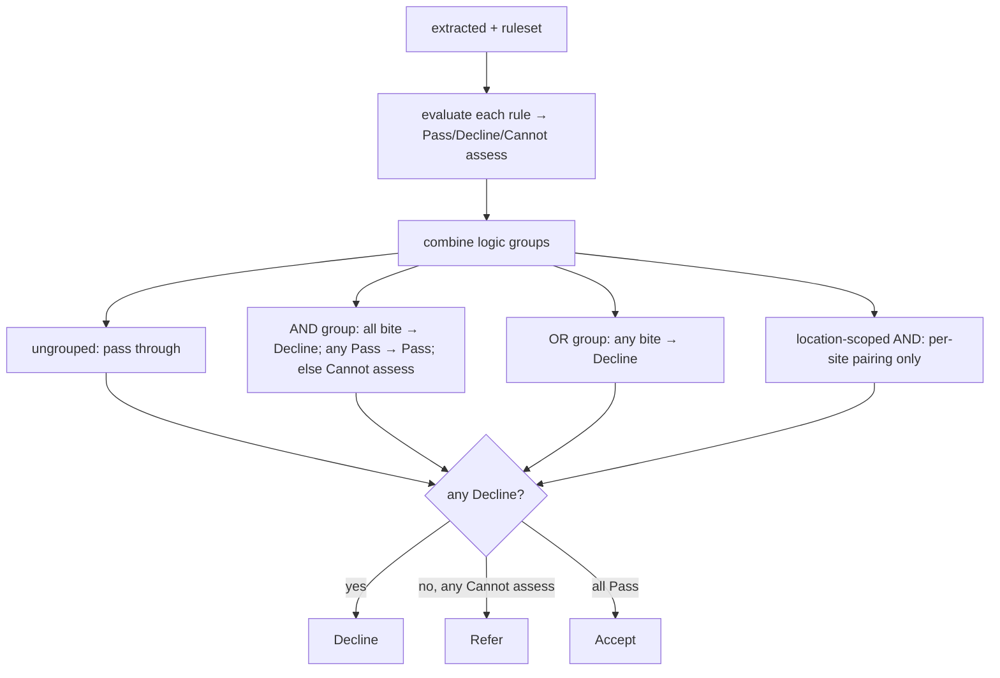

# appetite.py — deterministic rules + logic groups

**Business context:** BFR-APP-002 (tri-state), BFR-APP-004 (deterministic, no LLM), BFR 7.4 (logic groups), OPEN-10 (unspecified valuation → Refer, not Decline). Per-site pairing prevents cross-site false positives.

## Example run

binder_A clean submission: A-001 section limit 2M ≤ 2M → Pass; A-002 TIV 6.5M ≤ 10M → Pass; A-003a single claim 0 ≤ 50k → Pass; A-003b total 0 ≤ 100k → Pass; A-004 continental US true → Pass; A-005 sprinklered → Pass; A-006 valuation CIF+10% → Pass; A-007a ALL_RISK → Pass; A-007b inception 2030-06-01 future → Pass; A-008 expiring premium false → Pass; A-009 steel not in {LIVESTOCK,...} → Pass. No Decline, no Cannot assess → Accept.
