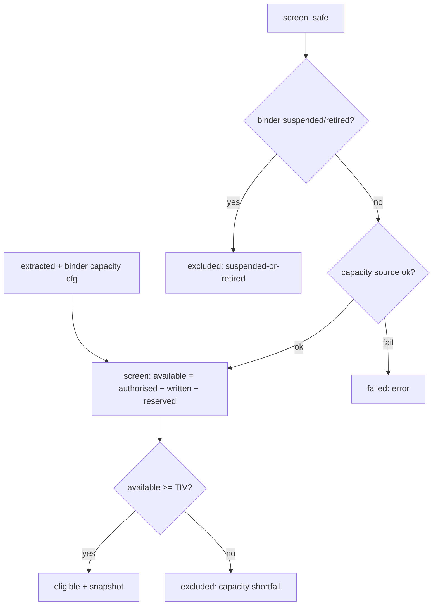

# capacity.py — derived capacity screening

**Business context:** capacity is derived, never stored (BFR-CAP-002); lifecycle filter (BFR-CAP-003) and source-failure safety (BFR-CAP-012) ensure a binder is never silently omitted.
