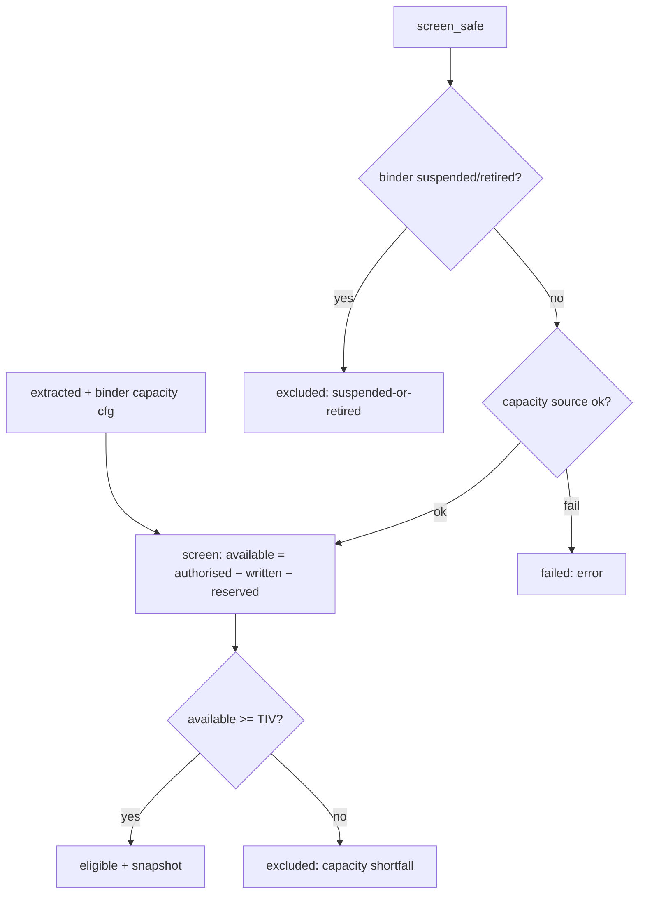
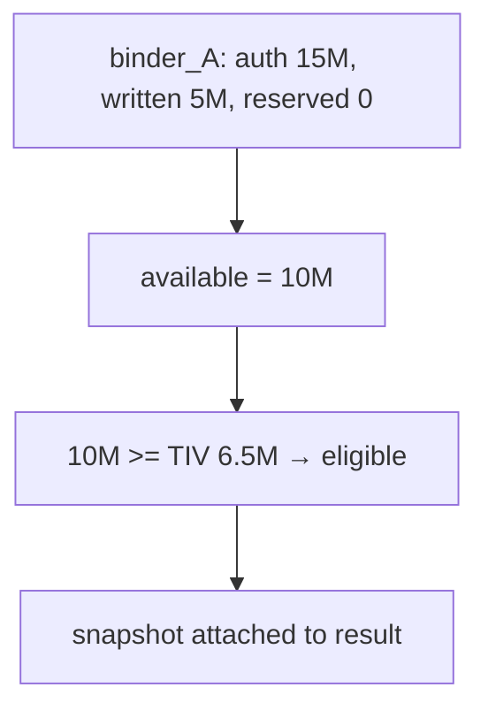

# capacity.py — derived capacity screening

**Business context:** capacity is derived, never stored (BFR-CAP-002); lifecycle filter (BFR-CAP-003) and source-failure safety (BFR-CAP-012) ensure a binder is never silently omitted.

## Example run

binder_A: authorised 15,000,000, written 5,000,000, reserved 0 → available 10,000,000 ≥ TIV 6,500,000 → eligible, snapshot attached. Suspended binder_B (hypothetical): screen_safe returns excluded:suspended-or-retired without touching capacity. Capacity source down: returns failed:... rather than omitting the binder.

## Example journey (in-flowchart)

