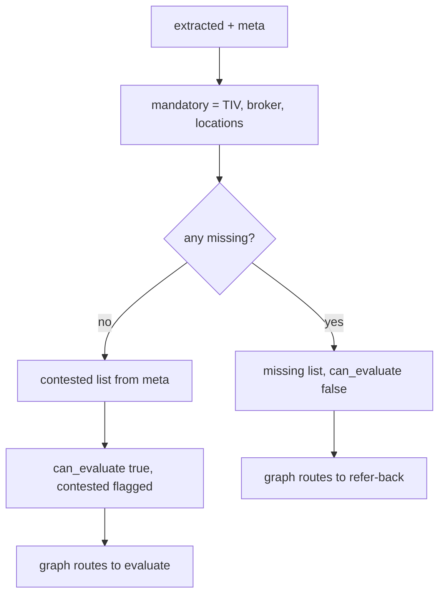

# completeness.py — mandatory + contested gate

**Business context:** BFR-APP-003 — missing mandatory data → Refer, never Pass. Contested fields surface to the underwriter rather than being silently resolved.
