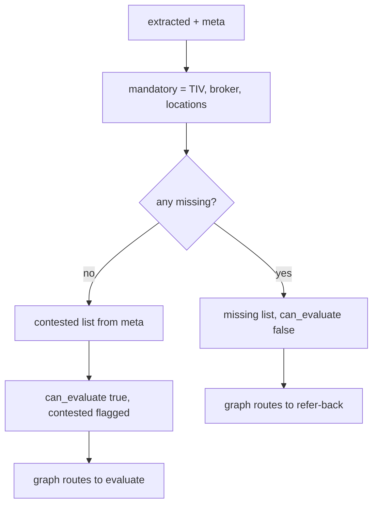
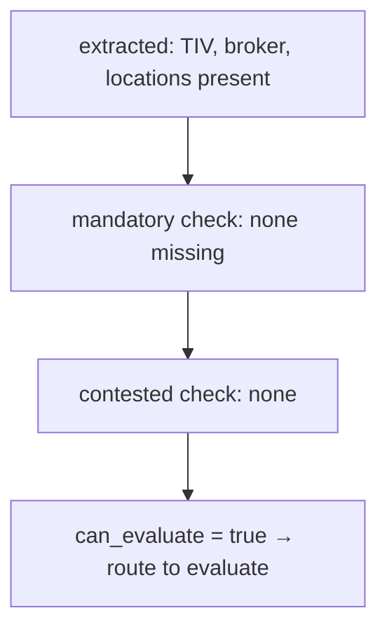

# completeness.py — mandatory + contested gate

**Business context:** BFR-APP-003 — missing mandatory data → Refer, never Pass. Contested fields surface to the underwriter rather than being silently resolved.

## Example run

Case 10 (missing commodities): extracted has TIV, broker, locations → mandatory ok, can_evaluate true, but commodity absent means A-009 Cannot assess → binder Refer. Contested case (two docs disagree on TIV): completeness.contested=["total_insured_value"], surfaced to underwriter, not silently resolved.

## Example journey (in-flowchart)

