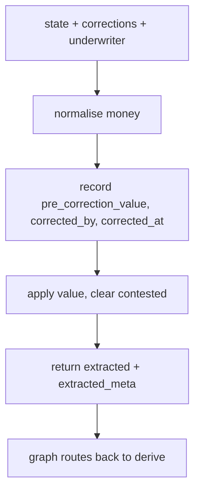

# correct.py — correction + re-evaluation trail

**Business context:** nothing overwritten silently — full audit trail (BFR-EXT-006/007). Corrections flow into the audit record and evidence pack.

## Example run

state extracted TIV 20,000,000 (from doc d1) contested. apply(state, {total_insured_value: "$5,000,000"}, "u-corr"): normalises to 5,000,000.0, records pre_correction_value=20,000,000.0, corrected_by="u-corr", corrected_at=ISO, contested=false, conflict removed. Graph re-runs derive→evaluate→rank→narrative→review.
