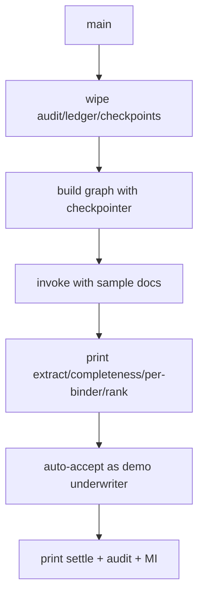
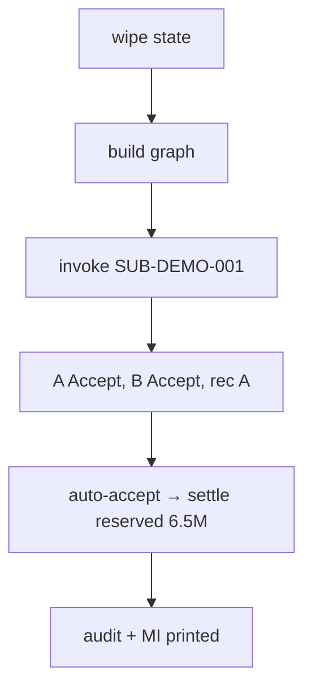

# demo.py — self-resetting end-to-end demo

**Business context:** deterministic stub extractor, no API key; demonstrates full gate chain and MI in one command.

## Example run

`python demo.py` wipes audit/ledger/checkpoints, runs SUB-DEMO-001, prints extract→completeness→per-binder (A Accept, B Accept)→rank (A 10.0)→auto-accept→settle (reserved 6.5M)→audit eval-…→MI. Ends with "1 passed" equivalent: 79 tests green.

## Example journey (in-flowchart)

