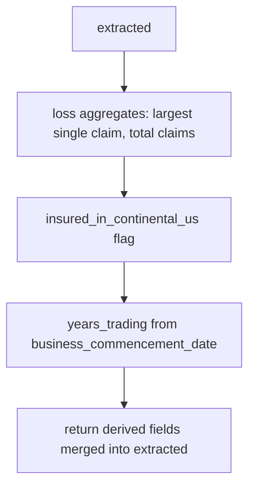

# derive.py — derived aggregates and flags

**Business context:** derived fields are computed, never stored (BFR 7.1.6); capacity is likewise derived (BFR-CAP-002). Rules reference derived fields by name.
