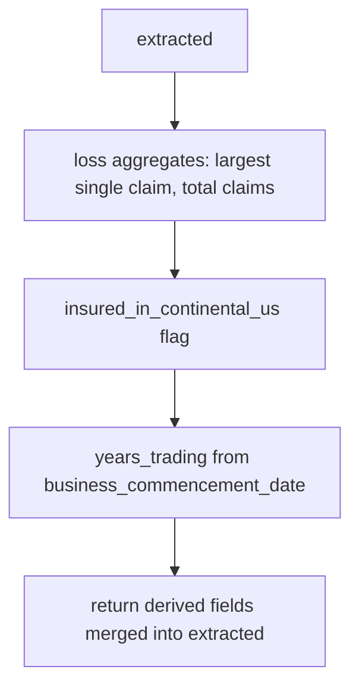

# derive.py — derived aggregates and flags

**Business context:** derived fields are computed, never stored (BFR 7.1.6); capacity is likewise derived (BFR-CAP-002). Rules reference derived fields by name.

## Example run

Input extracted: total_insured_value 6500000, largest_single_claim_amount 0, total_claims_amount 0, business_commencement_date "2020-01-01", insured_in_continental_us true.
Output adds: largest_single_claim_amount=0 (already), total_claims_amount=0, insured_in_continental_us=true, years_trading=6 (as of eval date). Rules A-003a/b and A-004 now have real values to evaluate against.
