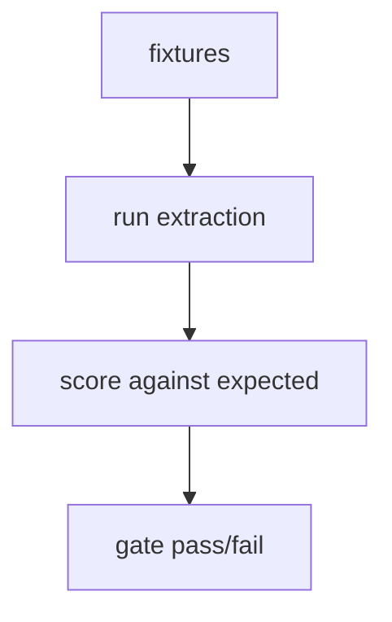

# scripts/eval_extraction.py — nightly extraction eval

**Business context:** nightly Nemotron extraction eval gate consuming repo secret.

## Example run

Nightly workflow runs `scripts/eval_extraction.py` against Nemotron on the 25 fixtures, scores field-level extraction, fails the gate if below threshold. Uses repo secret for API key.
