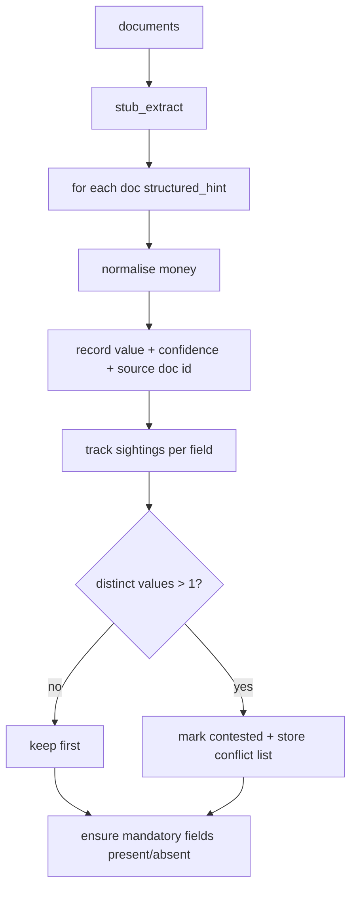

# extract.py — document → risk data

**Business context:** extraction never silently merges conflicting sources — dual provenance is preserved for the underwriter (BFR-EXT-004/006/007). Missing mandatory fields stay absent (not guessed), so completeness can Refer.
