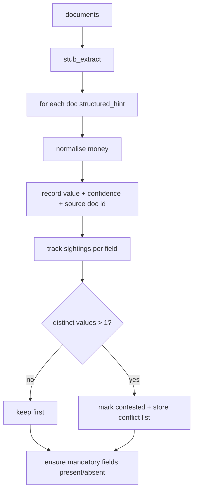

# extract.py — document → risk data

**Business context:** extraction never silently merges conflicting sources — dual provenance is preserved for the underwriter (BFR-EXT-004/006/007). Missing mandatory fields stay absent (not guessed), so completeness can Refer.

## Example run

Docs: mail-001 (TIV $6,500,000, broker Acme, 1 location sprinklered, steel) + sov-001 (empty hint).
stub_extract merges hints: total_insured_value=6500000.0 conf 1.0 src mail-001; broker_name="Acme Marine Ltd." conf 1.0; locations=[{address:"12 Port Road",sprinklered:true}]; commodities=[{commodity_type:"STEEL"}]. No conflicts (sov-001 adds nothing). Mandatory fields all present.
