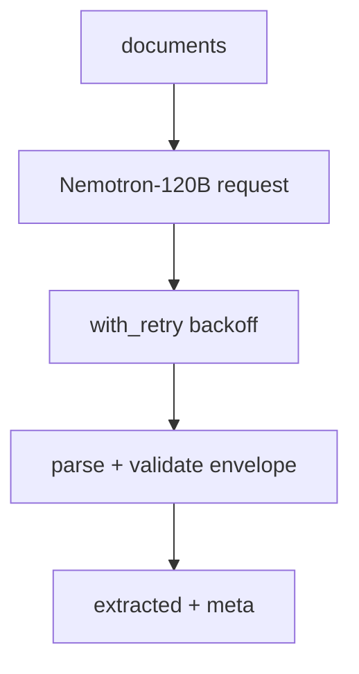

# extract_nvidia.py — live LLM extraction (NVIDIA Nemotron)

**Business context:** second live provider, same envelope contract, wired as `llm="nvidia"` (BFR-EXT-001). Used by the nightly extraction eval gate and local UI toggle.
