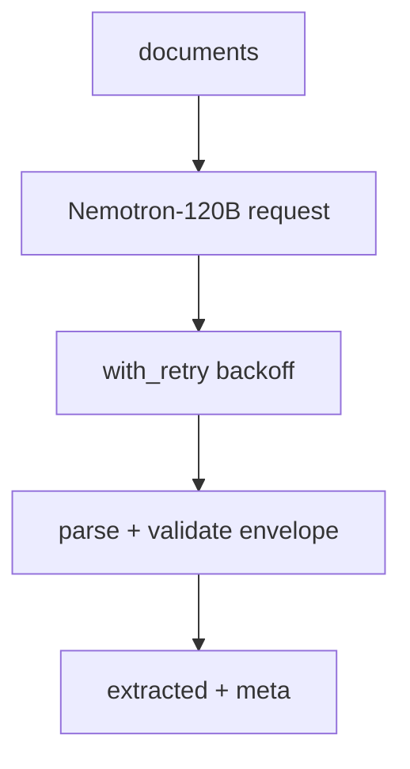
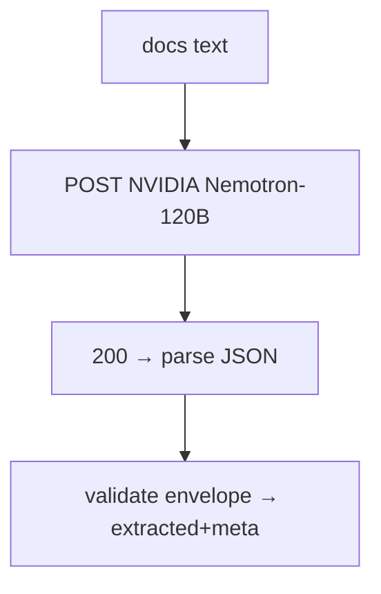

# extract_nvidia.py — live LLM extraction (NVIDIA Nemotron)

**Business context:** second live provider, same envelope contract, wired as `llm="nvidia"` (BFR-EXT-001). Used by the nightly extraction eval gate and local UI toggle.

## Example run

Env `NVIDIA_API_KEY` set. Calls Nemotron-120B with same envelope prompt. Used by nightly eval gate (scripts/eval_extraction.py) and local UI toggle. Returns extracted+meta identical in shape to stub/OpenRouter.

## Example journey (in-flowchart)

