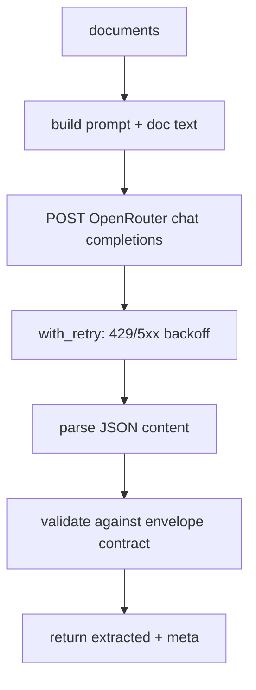

# extract_openrouter.py — live LLM extraction (OpenRouter)

**Business context:** live provider behind the same envelope contract as the stub, so the graph is provider-agnostic (BFR-EXT-001). Key read from env only, never stored. Default model `liquid/lfm-2.5-2.6b:free`.
