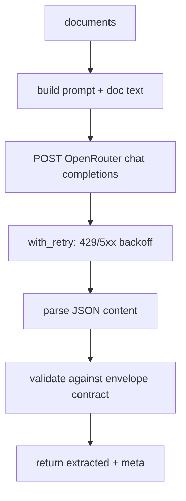

# extract_openrouter.py — live LLM extraction (OpenRouter)

**Business context:** live provider behind the same envelope contract as the stub, so the graph is provider-agnostic (BFR-EXT-001). Key read from env only, never stored. Default model `liquid/lfm-2.5-2.6b:free`.

## Example run

Env `OPENROUTER_API_KEY` set. POST to OpenRouter with model liquid/lfm-2.5-2.6b:free, temp 0. On 429, with_retry waits 0.5s then 1s then 2s. Parses JSON content from choices[0].message.content, strips code fences, returns extracted+meta. Verified live in tests/test_openrouter.py.
