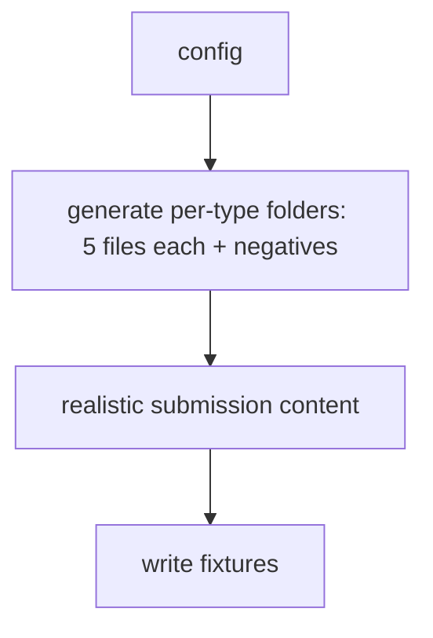
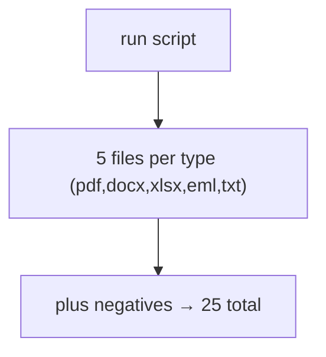

# scripts/gen_parse_fixtures.py — fixture generator

**Business context:** builds the 25-file parsing dataset (5 per type) with negatives.

## Example run

`python scripts/gen_parse_fixtures.py` writes 5 files per type (pdf, docx, xlsx, eml, txt) plus negatives into samples/parsing/, 25 total, each with realistic submission content.

## Example journey (in-flowchart)

