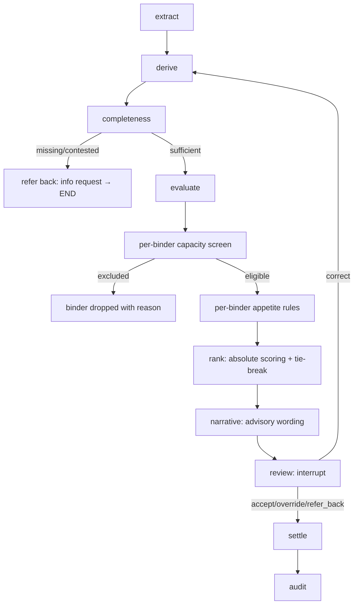
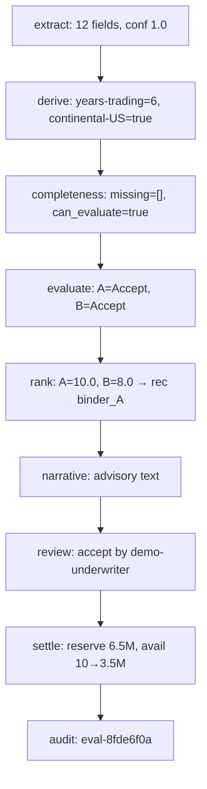

# graph.py — full gate chain

**Business context (BFR):** full pipeline BFR §5.1; completeness gate BFR-APP-003 (Refer, never Pass); capacity BFR-CAP-002 (derived); appetite BFR-APP-004/005 (deterministic); rank BFR-REC-003/005/006 (absolute); review BFR-UWR (human decides); settle BFR-CAP-008/009; audit BFR-AUD. Correction loop returns to derive so re-evaluation re-runs every gate.

## Example run

Input: `SUB-DEMO-001`, two docs, Acme Marine, TIV $6.5M, 1 sprinklered location, steel.
1. extract → 12 fields, conf 1.0
2. derive → years-trading, continental-US, loss aggregates 0
3. completeness → all mandatory present, can_evaluate true
4. evaluate → binder_A Accept, binder_B Accept (both eligible)
5. rank → A=10.0 (preferred), B=8.0 (standard) → recommendation binder_A
6. narrative → advisory text (no "bound/placed")
7. review → interrupt; underwriter sends `{action: "accept"}`
8. settle → reserve 6.5M against binder_A (available 10M → 3.5M)
9. audit → `eval-…` written to decisions.jsonl

## Example journey (in-flowchart)

