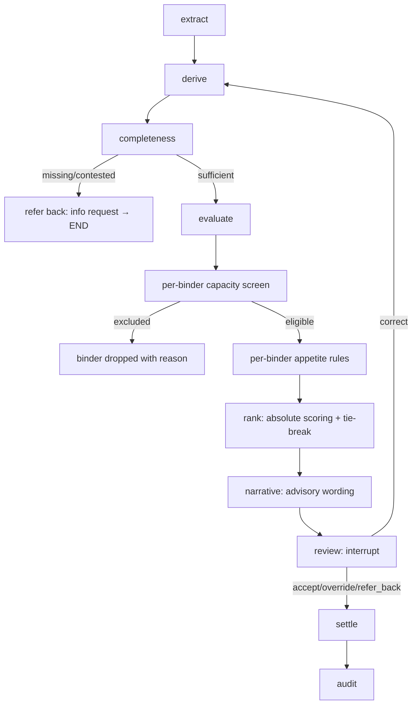

# graph.py — full gate chain

**Business context (BFR):** full pipeline BFR §5.1; completeness gate BFR-APP-003 (Refer, never Pass); capacity BFR-CAP-002 (derived); appetite BFR-APP-004/005 (deterministic); rank BFR-REC-003/005/006 (absolute); review BFR-UWR (human decides); settle BFR-CAP-008/009; audit BFR-AUD. Correction loop returns to derive so re-evaluation re-runs every gate.
