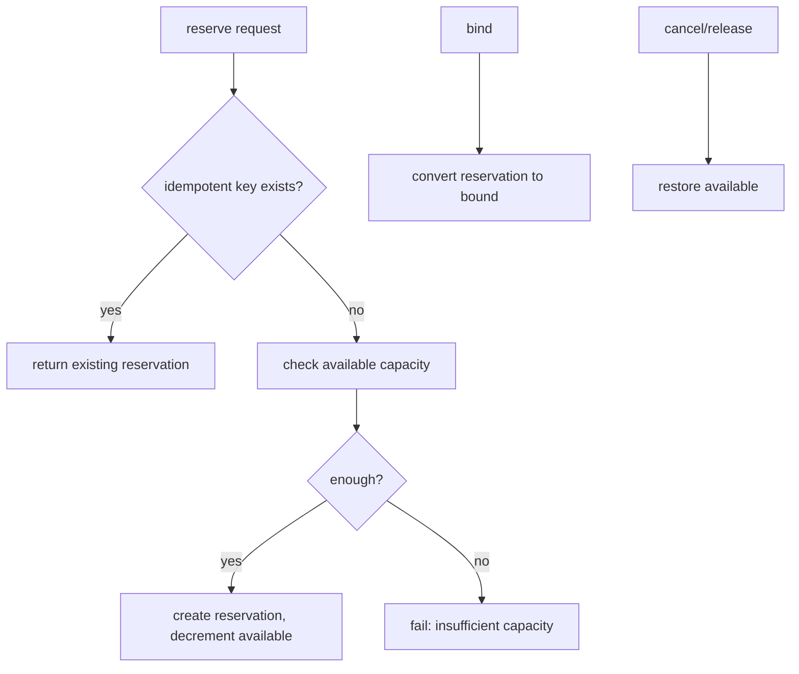

# ledger.py — idempotent capacity reservation

**Business context:** BFR-CAP-008/009 — idempotent reserve/bind/cancel/release; capacity never stored, always derived.

## Example run

reserve(binder_A, 6,500,000, key="sub-1"): first call creates res-17010f98, available 10M→3.5M. Repeat with same key returns existing reservation (idempotent). bind(res-17010f98) converts to bound. cancel restores 3.5M→10M.
