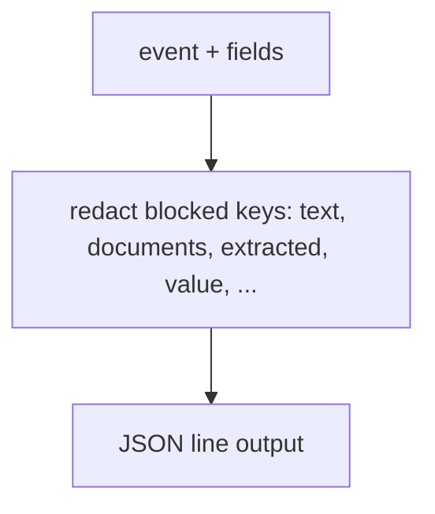
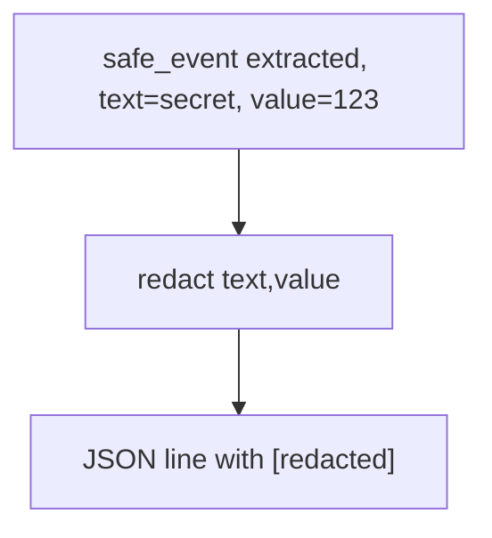

# log.py — content-redacting logs

**Business context:** NFR-003/024 — structured logs never carry submission content.

## Example run

safe_event("extracted", submission_reference="S", text="secret policy text", value=123, outcome="Accept") → '{"event":"extracted","submission_reference":"S","text":"[redacted]","value":"[redacted]","outcome":"Accept"}'.

## Example journey (in-flowchart)

