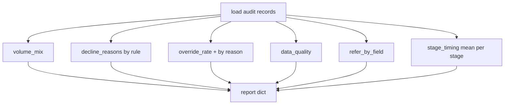
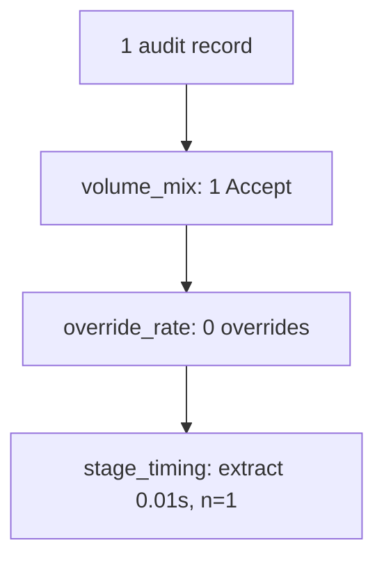

# mi.py — MI reports

**Business context:** MI-001..006 — volume, decline rank, override rate, quality, refer-by-field, stage timings.

## Example run

report() after one accepted submission: volume_mix {total:1, by_outcome:{Accept:1}, by_broker:{Acme Marine Ltd.:1}}, override_rate {decided:1, overrides:0, rate:0.0}, stage_timing {mean_seconds:{extract:0.01,...}, n:1}.

## Example journey (in-flowchart)

