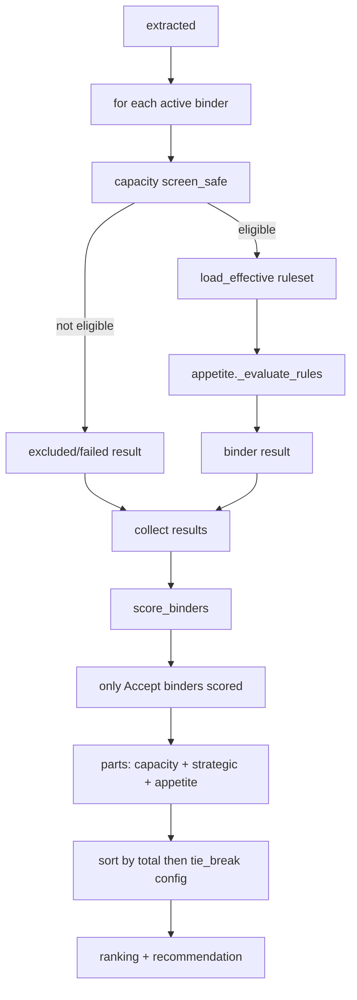

# multibind.py — per-binder eval + absolute ranking

**Business context:** binders are data, not agents (BFR-APP-011); scoring absolute, not relative (BFR-REC-005); tie-break configured (BFR-REC-006, OPEN-5). Removing a binder does not change others' scores.
