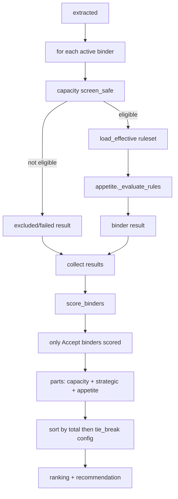

# multibind.py — per-binder eval + absolute ranking

**Business context:** binders are data, not agents (BFR-APP-011); scoring absolute, not relative (BFR-REC-005); tie-break configured (BFR-REC-006, OPEN-5). Removing a binder does not change others' scores.

## Example run

evaluate_binders on clean submission: binder_A Accept (all 9 pass), binder_B Accept (all 7 pass) — both eligible. score_binders: A 5+2+3=10.0 (preferred), B 5+0+3=8.0 (standard). ranking [binder_A, binder_B], recommendation binder_A. Removing binder_B from the list leaves A's score unchanged (absolute scoring).
