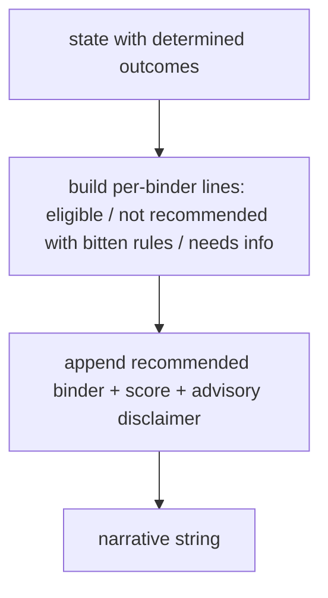
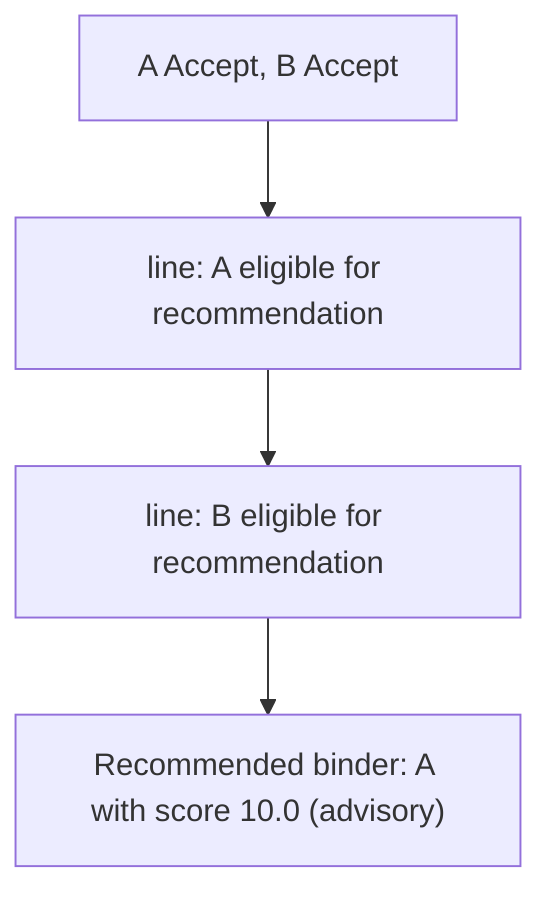

# narrative.py — advisory wording only

**Business context:** BFR-REC-007/008/010/011 — describes already-determined outcomes, decides nothing; never says bound/placed; LLM may rephrase but not add conclusions.

## Example run

Clean submission: "Submission SUB-DEMO-001 from Acme Marine Ltd. (TIV 6500000) was evaluated against 2 binders. - binder_A: eligible for recommendation. - binder_B: eligible for recommendation. Recommended binder: binder_A with score 10.0. This is advisory; a named underwriter decides." No "bound"/"placed" wording.

## Example journey (in-flowchart)

