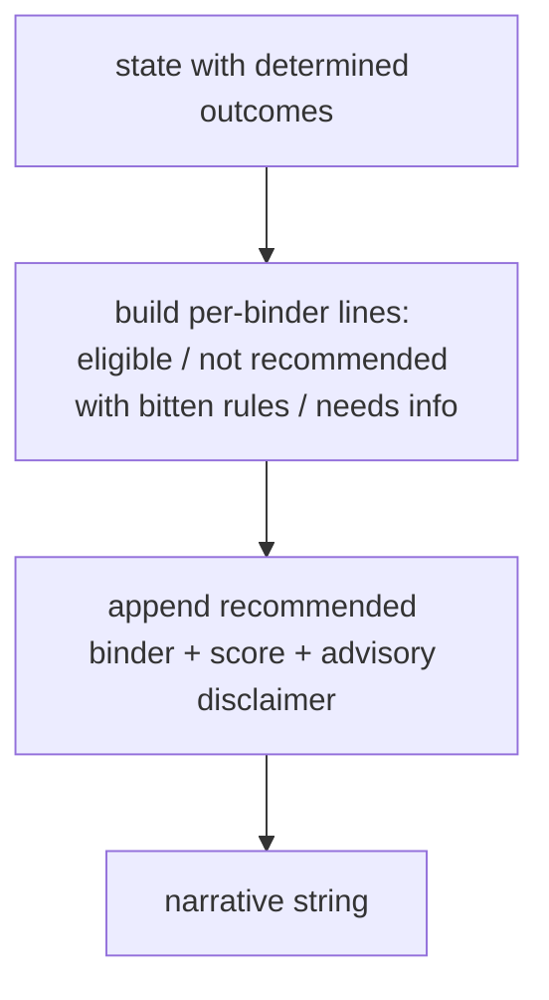

# narrative.py — advisory wording only

**Business context:** BFR-REC-007/008/010/011 — describes already-determined outcomes, decides nothing; never says bound/placed; LLM may rephrase but not add conclusions.
