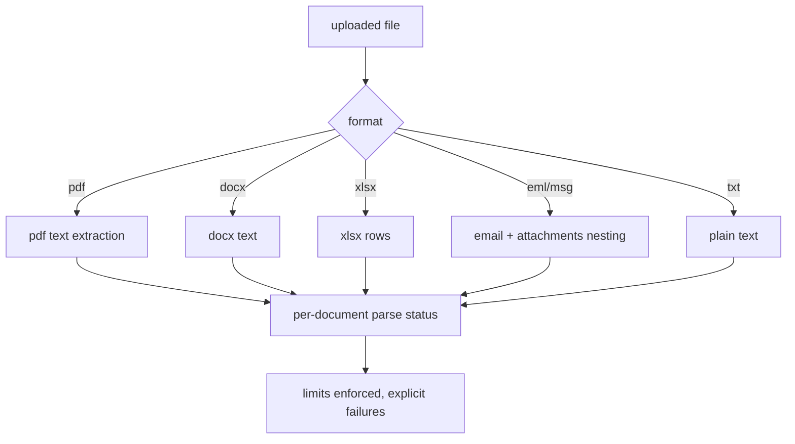
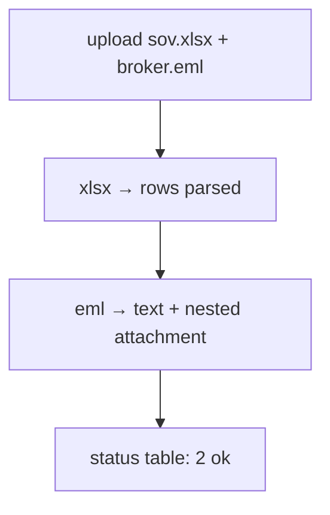

# parse.py — document parsing (5 formats)

**Business context:** real document intake (BFR-EXT); nesting for emails; explicit failures rather than silent skips; limits enforced.

## Example run

Upload "sov.xlsx": format=xlsx → rows parsed into locations/commodities; parse status "ok". Upload "broker.eml" with attachment "sov.pdf": nesting extracts both; status table shows 2 docs. Oversized file → explicit failure, not silent skip.

## Example journey (in-flowchart)

