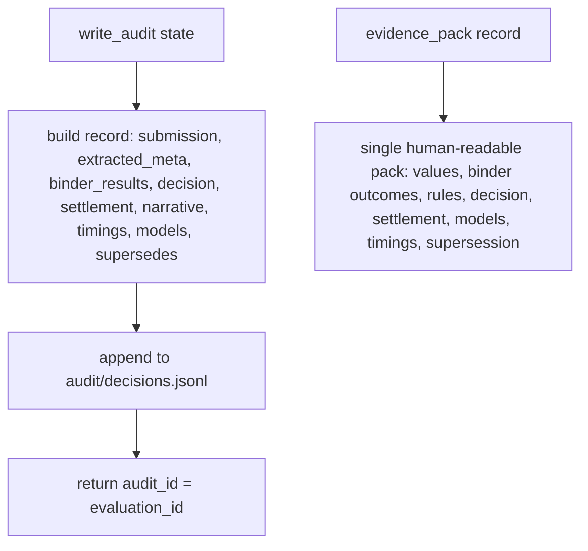

# persistence.py — audit, evidence pack, supersession

**Business context:** immutable audit record per evaluation (BFR-AUD-001/002); re-evaluations leave the original intact and link via `supersedes` (BFR-AUD-004); evidence pack is the single artefact for review (BFR-AUD-008). No secrets or absolute paths stored.

## Example run

After accept: `write_audit` appends one JSON line to `audit/decisions.jsonl` with audit_id `eval-8fde6f0a`, submission_reference, extracted_meta (12 fields), binder_results (A Accept, B Accept), scores {A:10.0, B:8.0}, recommendation binder_A, decision {action:accept, underwriter:demo-underwriter, decided_at}, settlement {action:reserved, binder:binder_A, available:3500000}, narrative, stage_timings, model_versions {extraction:stub-1}, supersedes null.
