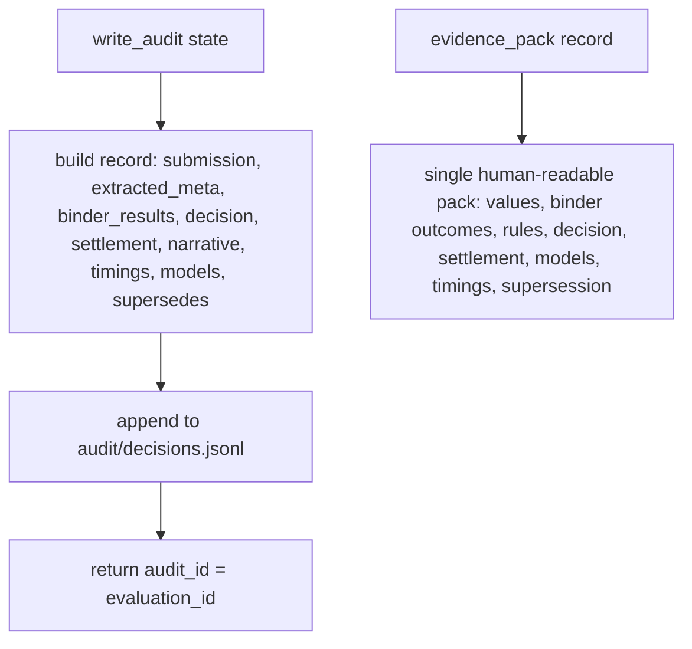

# persistence.py — audit, evidence pack, supersession

**Business context:** immutable audit record per evaluation (BFR-AUD-001/002); re-evaluations leave the original intact and link via `supersedes` (BFR-AUD-004); evidence pack is the single artefact for review (BFR-AUD-008). No secrets or absolute paths stored.
