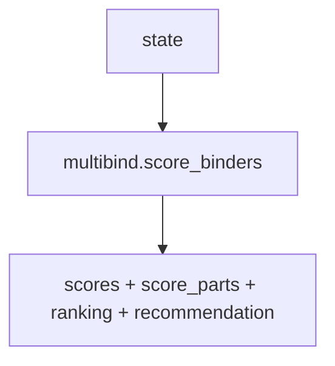
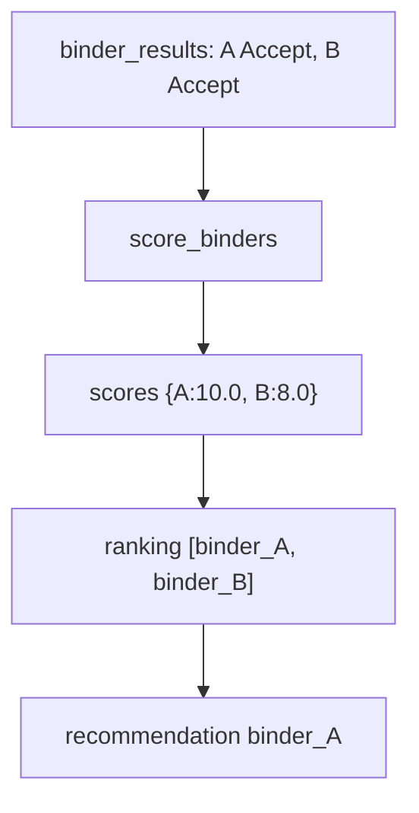

# rank.py — scoring wrapper

**Business context:** thin wrapper so the graph node name stays `rank`; all logic lives in multibind (BFR-REC-003/005/006).

## Example run

rank node reads state.binder_results, calls score_binders, writes state.scores={A:10.0,B:8.0}, state.score_parts, state.ranking=["binder_A","binder_B"], state.recommendation="binder_A".

## Example journey (in-flowchart)

