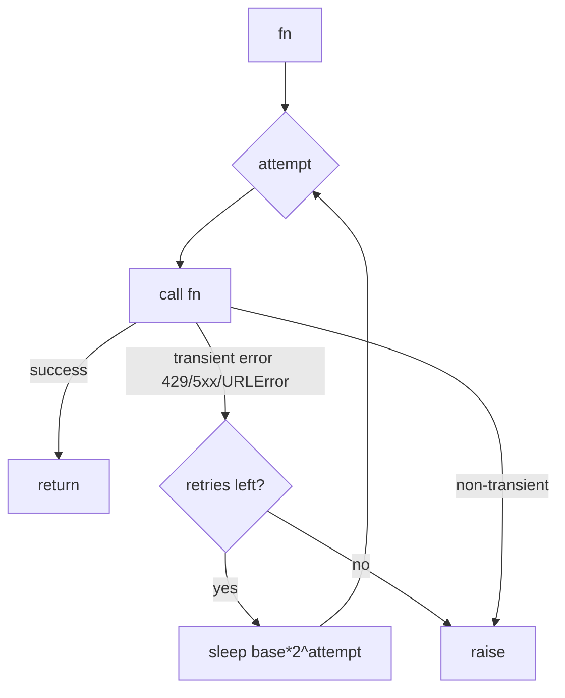
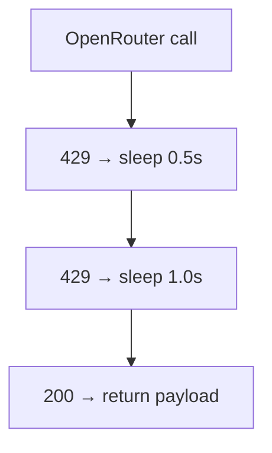

# retry.py — bounded backoff

**Business context:** NFR-016 — transient failures retried with backoff; non-transient fail fast; blast radius bounded.

## Example run

OpenRouter returns 429 twice then 200: with_retry calls fn 3 times, sleeping 0.5s then 1.0s, returns the 200 payload. A 400 (non-transient) raises immediately on first attempt.

## Example journey (in-flowchart)

