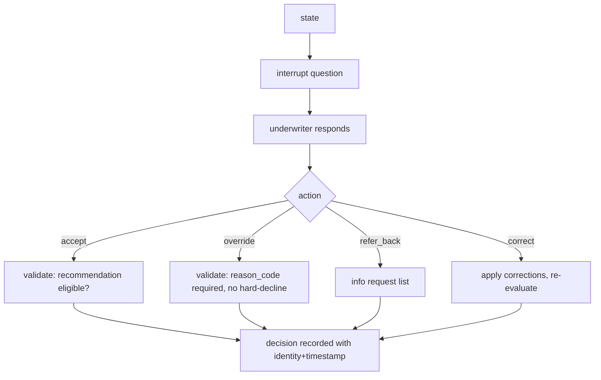
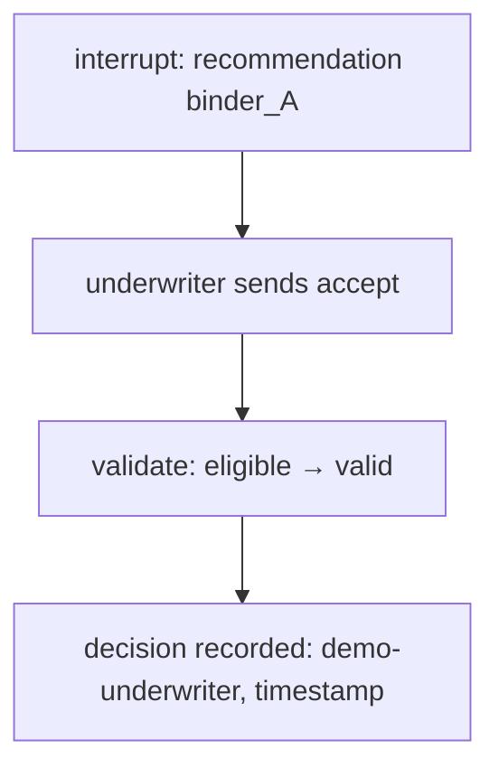

# review.py — human decision gate

**Business context:** underwriter decides, system only recommends (BFR 2.4, BFR-UWR); override needs reason code (BFR-UWR-005); hard-decline selection blocked (BFR-UWR-007); identity + timestamp (BFR-UWR-006); correct triggers re-evaluation (BFR-EXT-006/007).

## Example run

Underwriter sends `{action:"accept", underwriter_id:"demo-underwriter"}`. validate checks recommendation eligible → valid. decision recorded with identity + timestamp. Underwriter sends `{action:"correct", corrections:{total_insured_value:5000000}}` → graph routes back to derive and re-evaluates; decision recorded with corrections.

## Example journey (in-flowchart)

