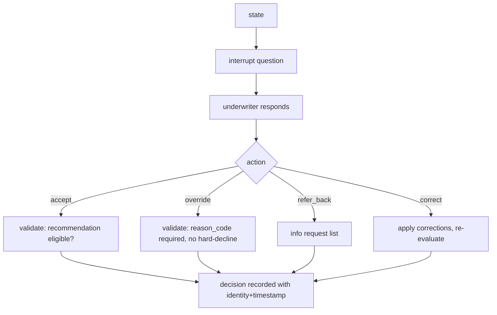

# review.py — human decision gate

**Business context:** underwriter decides, system only recommends (BFR 2.4, BFR-UWR); override needs reason code (BFR-UWR-005); hard-decline selection blocked (BFR-UWR-007); identity + timestamp (BFR-UWR-006); correct triggers re-evaluation (BFR-EXT-006/007).
