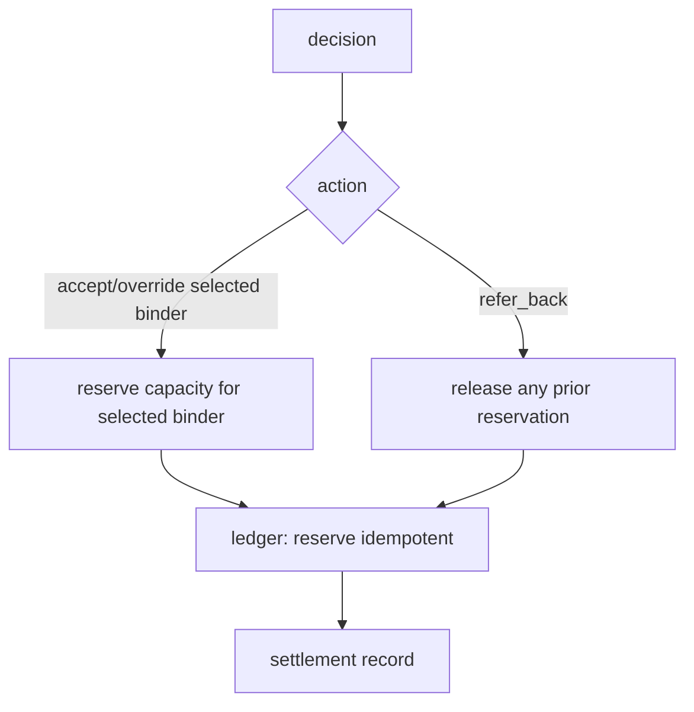

# settle.py — capacity reservation / release

**Business context:** BFR-CAP-008/009 — bind only on underwriter decision; idempotent reservation prevents double-counting.

## Example run

decision accept binder_A: reserve 6,500,000 → ledger available 10,000,000 → 3,500,000, reservation_id res-17010f98, deduped false. decision refer_back: release prior reservation, available restored.
