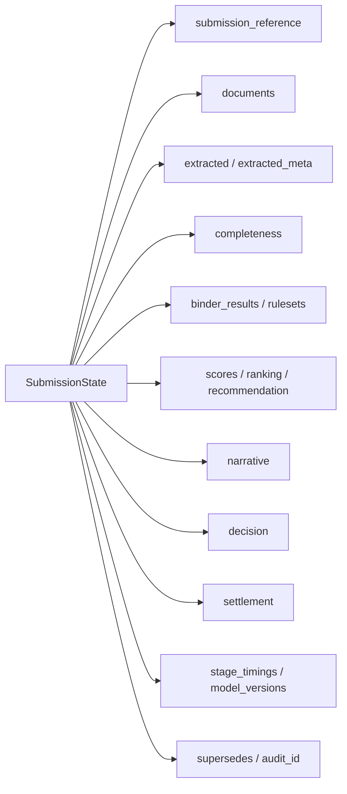

# state.py — submission state contract

**Business context:** single typed contract shared by every node; carries extracted risk data, per-binder outcomes, cross-binder ranking, underwriter decision, settlement, audit linkage, timings and model versions. `supersedes` links re-evaluations to the original record (BFR-AUD-004).
