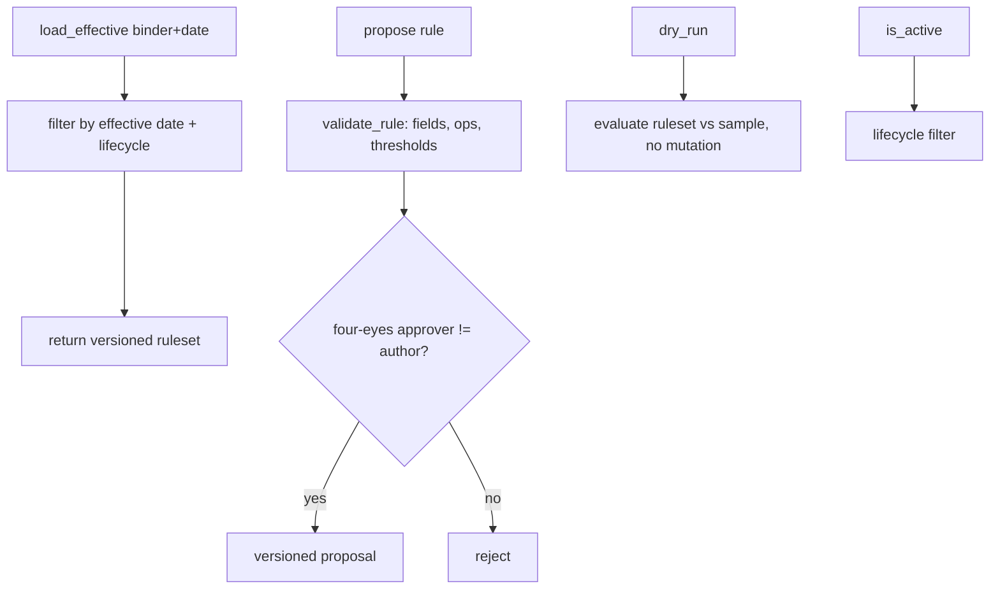

# store.py — rule versioning, four-eyes, dry-run

**Business context:** rules are structured versioned JSON, never prompt text (BFR 7.2); four-eyes (BFR 7.5); effective-date versioning (BFR 7.3); dry-run before activation.

## Example run

load_effective("binder_A", "2026-09-29") → v1 (3 rules); load_effective("binder_A", "2026-09-30") → v2 (9 rules). propose by author "alice" needs approver != "alice" (four-eyes). dry_run evaluates v2 against a sample submission without mutating.
