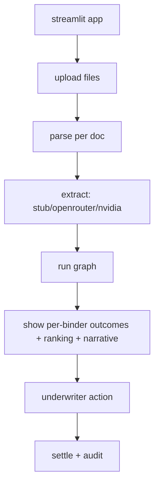
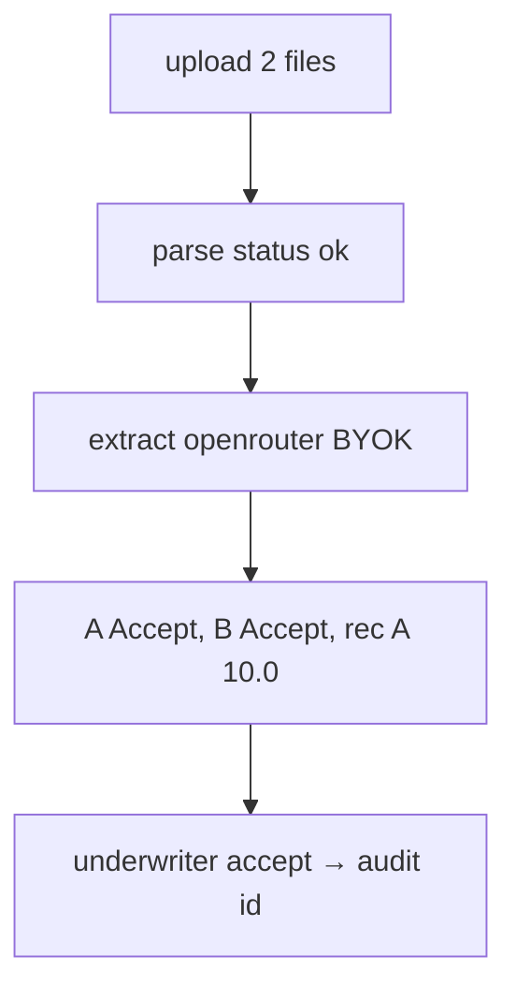

# ui/app.py — local UI

**Business context:** local UI over the same graph; supports BYOK OpenRouter/NVIDIA; shows parse status table.

## Example run

User uploads sov.xlsx + broker.eml, picks llm="openrouter" with BYOK key, clicks Run. UI shows parse status table (2 ok), per-binder outcomes (A Accept, B Accept), ranking bar (A 10.0 > B 8.0), narrative, then underwriter accept → settle + audit id.

## Example journey (in-flowchart)

