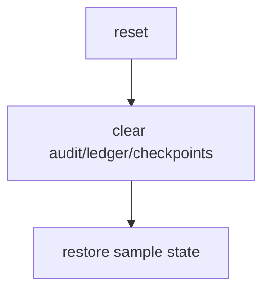
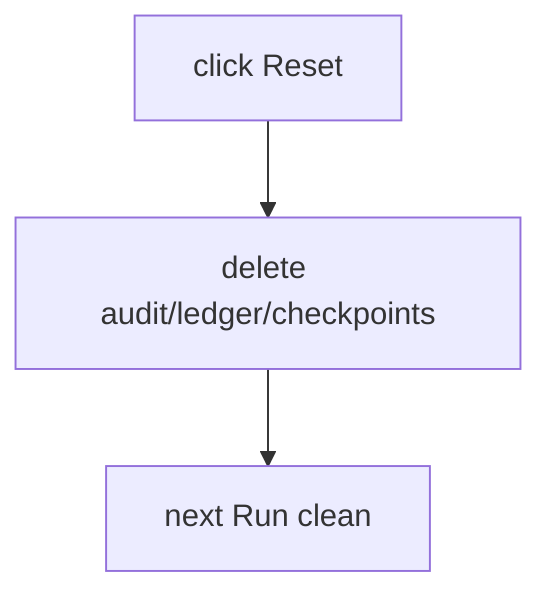

# ui/reset_demo.py — demo reset

**Business context:** resets demo to clean state for repeatable demos.

## Example run

Click "Reset demo" → deletes audit/decisions.jsonl, ledger.json, .checkpoints.sqlite → next Run starts from clean state.

## Example journey (in-flowchart)

