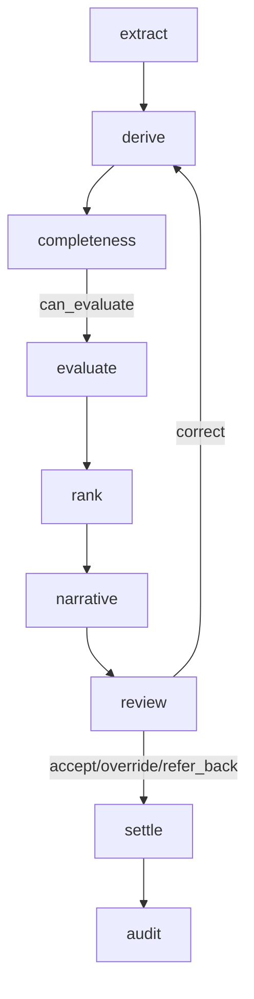

# Nodes package

This directory contains the execution nodes for the Binder Selection Agent workflow. Each node represents a single stage in the decision pipeline and is designed to be deterministic, auditable, and easy to test. The package is orchestrated by `graph.py` and forms the operational core of the repository.

The folder is intentionally split into responsibility-specific modules:

- extraction: read and normalize submission input
- derivation: compute missing field values from known data
- completeness: gate incomplete submissions before evaluation
- evaluation: capacity and appetite assessment across binders
- ranking: score eligible binders
- narrative: convert deterministic results into plain-language text
- review: support human review and corrections
- settlement: reserve or release binder capacity
- timing: record execution timing metadata for MI and debugging

---

## Purpose of the folder

The `nodes/` package implements the decision engine behind the binder-selection capability. It is built around the following idea:

- Models or external extraction services may read documents and normalize values.
- Deterministic Python logic decides eligibility, ranking, and capacity.
- The human reviewer may override a recommendation, but only with recorded justification.
- Every decision is tied back to evidence and auditable state.

This separation is important. The project is designed so that a language model is allowed to read or explain, but not to make the final decision without review and traceability.

---

## Execution flow

The main graph is wired in `graph.py` and follows this sequence:



The main stage order is:

1. `extract` - turn inbound documents into structured risk fields
2. `derive` - infer missing risk metrics from extracted data
3. `completeness` - ensure the minimum mandatory data is present
4. `evaluate` - check binder capacity and appetite rules
5. `rank` - assign absolute scores and recommend a binder
6. `narrative` - summarise the outcome in human-readable text
7. `review` - pause for underwriter review or correction
8. `settle` - reserve or release capacity based on the decision
9. `audit` - persist a traceable outcome record

---

## File-by-file overview

### `__init__.py`

Empty package marker. This makes the `nodes` folder importable as a Python package and keeps the modules organized as a namespace package.

### `extract.py`

Responsible for the initial conversion of submission documents into structured risk fields.

Key responsibilities:

- read `documents` from state
- normalize money values like `$5,000,000` into numeric floats
- store field provenance in `extracted_meta`
- mark absent fields clearly instead of inventing them
- support either a stub extractor or a live extractor route via `llm='openrouter'`

Important characteristics:

- fields are extracted without deciding business outcomes
- missing values remain `None` when absent
- value conflicts are tracked in metadata with `contested` or `conflict` flags

Typical output:

```python
{
  "extracted": {
    "total_insured_value": 5000000.0,
    "broker_name": "Acme",
    "locations": [{"sprinklered": True}],
    "commodities": [{"commodity_type": "STEEL"}]
  },
  "extracted_meta": {
    "total_insured_value": {"present": True, "confidence": 1.0, "value": 5000000.0}
  }
}
```

### `extract_openrouter.py`

Live extraction path for OpenRouter-backed LLM extraction.

Key responsibilities:

- call the OpenRouter chat completion endpoint
- request JSON only
- validate the returned data before accepting it
- map the model output back to the internal extracted field schema
- enforce no invented values when fields are absent

Environment variables:

- `OPENROUTER_API_KEY` - required for live extraction
- `OPENROUTER_MODEL` - optional override for model selection

This is a practical bridge between unstructured documents and the deterministic downstream logic.

### `derive.py`

Calculates derived fields that are not always provided explicitly in the source documents.

Examples:

- `largest_single_claim_amount` from the largest loss entry
- `total_claims_amount` from the sum of loss values
- `claim_count_3_years` and `claim_count_5_years`
- `years_trading` from `business_commencement_date`
- `insured_in_continental_us` from country and state information

The logic is intentionally non-creative: it derives what is mathematically evident from already-extracted inputs, without overriding explicit values.

### `completeness.py`

Implements the completeness gate before binder evaluation.

Mandatory fields:

- `total_insured_value`
- `broker_name`
- `locations`

The node returns:

```python
{
  "completeness": {
    "missing": [...],
    "contested": [...],
    "can_evaluate": True or False
  }
}
```

If required values are missing, the workflow stops and directs the process into a refer-back / information-request route rather than evaluating with partial data.

### `appetite.py`

Evaluates binder appetite rules against the extracted submission data.

This module contains:

- rule lookup and evaluation helpers
- field extraction logic for nested values
- operator support for comparisons such as `lte`, `gte`, `in`, `is_present`, etc.
- grouped logic support via `logic_group`
- final binder outcome classification:
  - `Accept`
  - `Decline`
  - `Cannot assess`

This is one of the key modules that keeps the business decision logic deterministic. It never calls an LLM.

### `capacity.py`

Capacity screening logic.

It computes:

```python
available_capacity = authorised_line - written_to_date - reserved
```

Then decides whether a binder is eligible for the submission based on whether there is enough free capacity.

The file also includes a safe wrapper:

- `screen()` - basic calculation
- `screen_safe()` - accounts for binder lifecycle status and failure handling

This node is designed to return explicit failure reasons instead of silently treating a binder as eligible.

### `multibind.py`

The multi-binder evaluation engine.

Responsibilities:

- load active binders from the binder registry
- screen each binder for capacity eligibility
- evaluate each binder's effective ruleset
- gather per-binder results and rule outcomes
- assign scores based on a deterministic scoring model
- produce ranking and recommendation data

Important outputs:

- `binder_results`: all per-binder outcomes
- `rulesets`: rule definitions by binder
- `scores`: absolute binder scores
- `ranking`: ordered list of eligible binders
- `recommendation`: selected binder or `no eligible binder`

This is the module that cross-compares binders and decides which binder is most favorable to recommend.

### `rank.py`

A lightweight absolute-scoring placeholder for rank logic. It is intentionally simple and stable. In the broader workflow, ranking is largely handled by the scoring logic in `multibind.py`, but this file exposes a dedicated score/rank pattern.

### `narrative.py`

Creates a human-readable narrative based on already-determined outcomes.

This module does not decide anything. It simply turns the structured results into wording like:

- which binders were evaluated
- which binders were eligible
- which rule outcomes caused decline or referral
- which binder is recommended and with what score

This is specifically designed to avoid making or inventing business conclusions.

### `review.py`

Underwriter review node.

This is where the system pauses for human intervention. It uses `langgraph.types.interrupt` to request a review decision from a person.

Supported actions:

- `accept`
- `override`
- `refer_back`
- `correct`

It validates the review payload and blocks invalid workflows. For example:

- override requires a valid `reason_code`
- accept cannot be used when no binder is recommended
- hard-decline rules cannot be overridden without a properly justified path
- correction values are re-applied to the extracted state

This is the part of the workflow that makes the system human-in-the-loop rather than fully autonomous.

### `correct.py`

Applies an underwriter-supplied correction to contested field values.

Responsibilities:

- update extracted values with corrected versions
- keep `pre_correction_value` for traceability
- record who corrected the value and when
- clear contested status after correction
- keep the audit trail explicit and non-destructive

This module is important because it preserves evidence when a human changes a value during review.

### `settle.py`

Finalizes the decision after a valid review result.

Logic:

- `accept` or `override` => reserve capacity for the chosen binder
- `refer_back` => release existing reservations for pending binders
- invalid decision => no settlement

This node manages the operational state transition from recommendation to actual booking or cleanup.

### `retry.py`

Provides a bounded retry mechanism for transient external failures.

It is used for network or upstream service issues where retrying is acceptable, but only for transient exceptions.

Characteristics:

- retries are bounded
- exponential backoff is applied
- `429` and `5xx` HTTP failures are treated as transient where appropriate
- non-transient exceptions re-raise immediately

### `log.py`

Provides structured, safe logging helpers.

It ensures that fields containing sensitive or bulky data are redacted before being logged. This is important because the project protects submission content and avoids leaking extracted payloads in logs.

### `timing.py`

Wraps each node with a timing decorator.

It records elapsed execution time per stage in `state["stage_timings"]` so the system can report:

- stage duration
- performance regressions
- human review wait time
- flow-level metrics for audit or MI dashboards

---

## Shared state contract

The workflow is state-driven. The nodes work from a shared `SubmissionState` object created by `state.py`.

Core state fields used by the nodes include:

- `submission_reference`
- `documents`
- `extracted`
- `extracted_meta`
- `completeness`
- `binder_results`
- `rulesets`
- `scores`
- `ranking`
- `recommendation`
- `decision`
- `settlement`
- `stage_timings`

This shared-state approach lets each node read the latest values and add its own output without needing a separate database call for each step.

---

## Deterministic design principles

This package follows several core principles:

1. Deterministic scoring and rule evaluation
   - Capacity and appetite logic is pure Python logic with no hidden AI decision making.

2. Explicit provenance
   - Extraction stores metadata so every field can be traced to a document or source location.

3. No silent inference
   - Missing data is marked missing; it is not guessed.

4. Human review as the control point
   - Review and correction are explicit and auditable.

5. Clear outcome reasons
   - Rules either pass, decline, or cannot be assessed.

6. Reproducible outcomes
   - The graph and rules are primarily data-driven, making the workflow deterministic and testable.

---

## Typical node contract

Most node functions in this folder follow a consistent contract:

```python
def some_node(state: dict) -> dict:
    # read relevant inputs from state
    # perform a business step
    # return a dictionary of new state fields
    return {"field_name": value}
```

This lets the LangGraph pipeline easily compose node outputs into a single shared state object.

---

## Why this folder matters

The `nodes/` folder is the operational heart of the Binder Selection Agent:

- it turns raw submission documents into structured risk data
- it enforces business rule checks consistently
- it prevents evaluation from proceeding with incomplete data
- it scores and ranks binders in a repeatable way
- it supports human intervention and correction
- it produces decision records suitable for audit and MI reporting

In short, this folder gives the repository the reliability, explainability, and traceability required for a decision-support workflow.

---

## Related files in the repo

- `graph.py` - orchestration of the node pipeline
- `state.py` - shared workflow state schema
- `rules/` - binder rule sets and scoring definitions
- `capacity/` - ledger and capacity accounting logic
- `persistence.py` - audit persistence
- `tests/` - validation and regression coverage

---

## Practical notes for contributors

When modifying this folder:

- keep business logic deterministic and testable
- do not move decision-making into an LLM path
- preserve auditable metadata on corrections or overrides
- keep rule outcomes explicit: `Pass`, `Decline`, or `Cannot assess`
- prefer small, single-responsibility modules
- update tests when changing behavior or state shape

---

## Summary

The `nodes/` directory is the repository’s processing engine. It combines extraction, validation, business rule evaluation, scoring, narrative generation, human review, and settlement into a clear, testable graph. Each file is focused on a single responsibility, and together they implement a controlled decision-support system rather than a black-box model-driven workflow.

This folder is the main place to look when you want to understand how a binder selection is derived, evaluated, challenged, and finalized.
